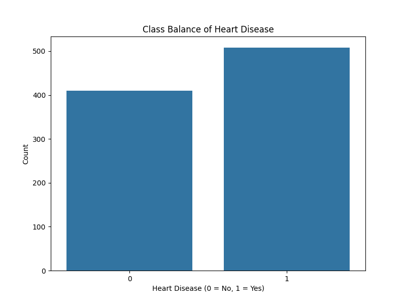
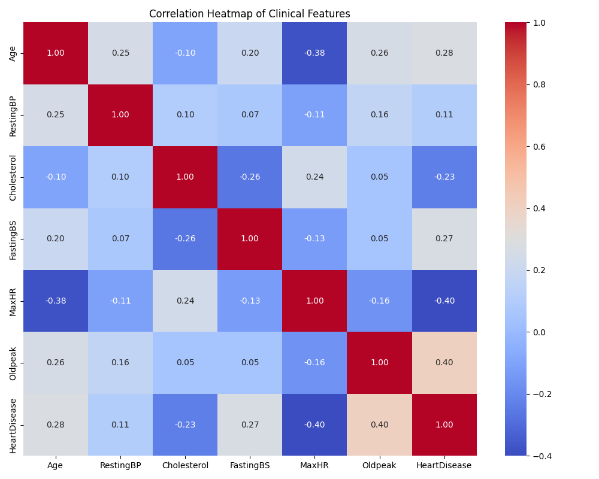
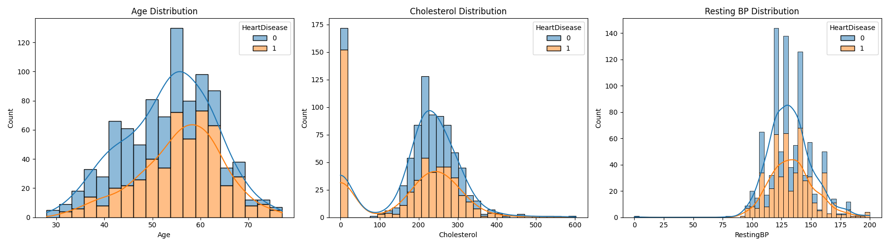

# EDA Report: Heart Disease Risk Classification

## Class Balance

**Finding:** The dataset is relatively balanced between patients with and without heart disease, with a slight majority having heart disease (class 1). This is a good baseline for training classification models without severe class imbalance issues.

## Correlation Heatmap

**Finding:** Oldpeak and Age show moderate positive correlations with HeartDisease, while MaxHR shows a negative correlation. Cholesterol and RestingBP have weaker correlations with the target variable compared to Oldpeak.

## Feature Distributions

**Findings:**
- **Age:** Older patients have a visibly higher proportion of heart disease compared to younger patients.
- **Cholesterol:** A significant number of instances have 0 cholesterol, which likely indicates missing values. Excluding those, the distribution for patients with heart disease tends to be slightly higher, but overlaps considerably.
- **Resting BP:** The distribution of resting blood pressure is fairly similar between the two groups, though mostly clustered between 120 and 140.
