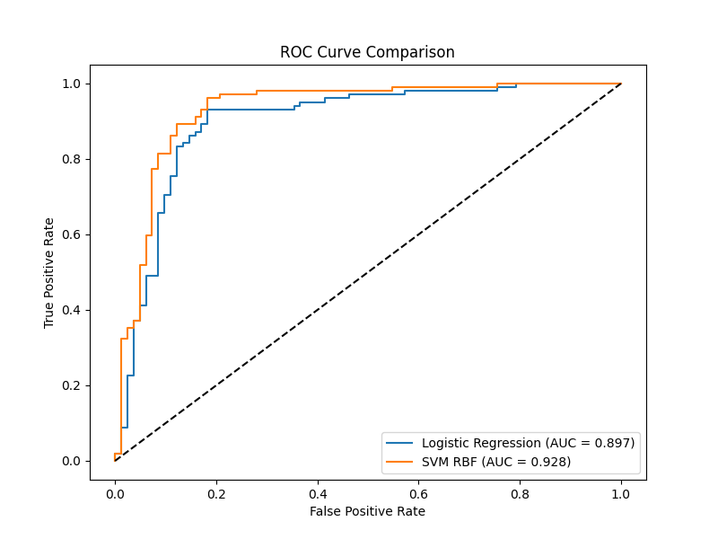
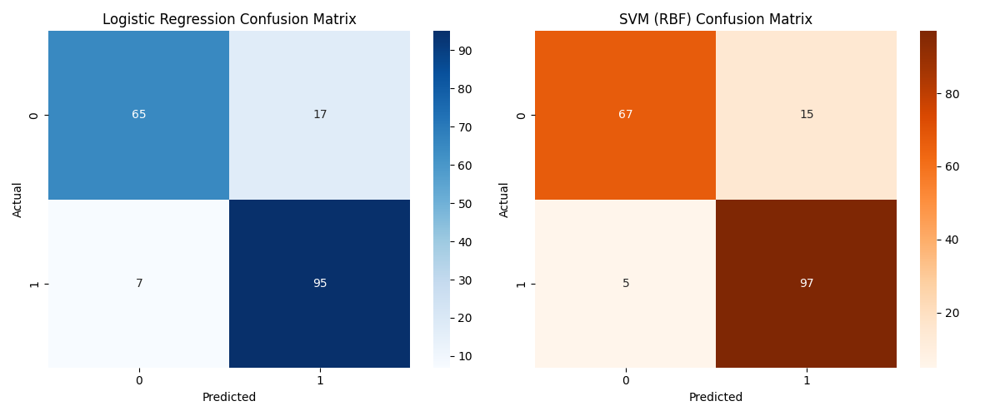

# Baseline Models Results

## Performance Metrics Table
|                     |   Accuracy |   Precision |   Recall |   F1 Score |   ROC-AUC |
|:--------------------|-----------:|------------:|---------:|-----------:|----------:|
| Logistic Regression |   0.869565 |    0.848214 | 0.931373 |   0.88785  |  0.897059 |
| SVM (RBF)           |   0.891304 |    0.866071 | 0.95098  |   0.906542 |  0.928264 |

## Overlaid ROC Curve

## Confusion Matrices

*Note: Used a single fixed-seed stratified train/val/test split (80/20 train/test, random_state=42).*
