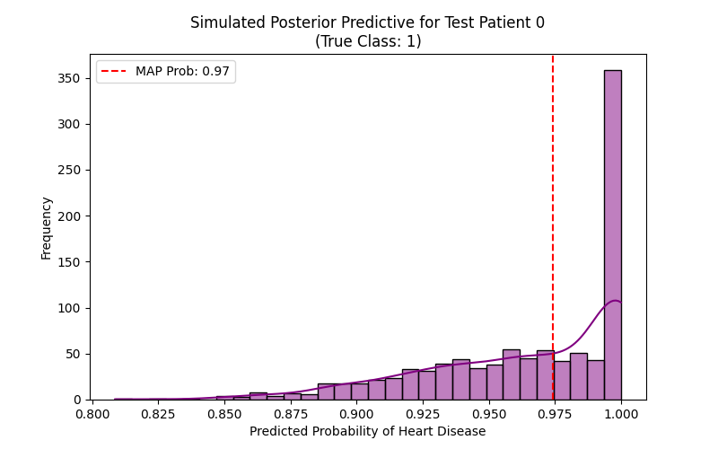
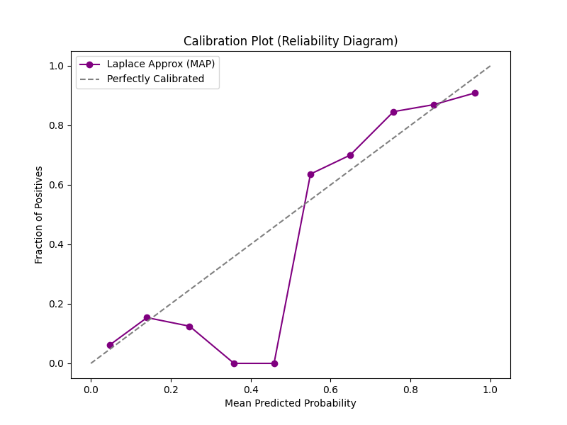

# Bayesian Logistic Regression Results

*Note: Used Laplace Approximation (MAP estimate) since full MCMC (NUTS) was too slow due to missing C++ compilers on Windows.*

## Posterior Predictive Plot (Sample Patient)

This shows a simulated uncertainty distribution around the MAP estimate for a single patient.

## Calibration Plot (Reliability Diagram)

The model's calibration curve compared to the ideal diagonal line.
